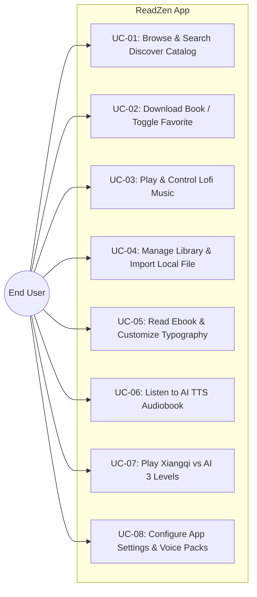
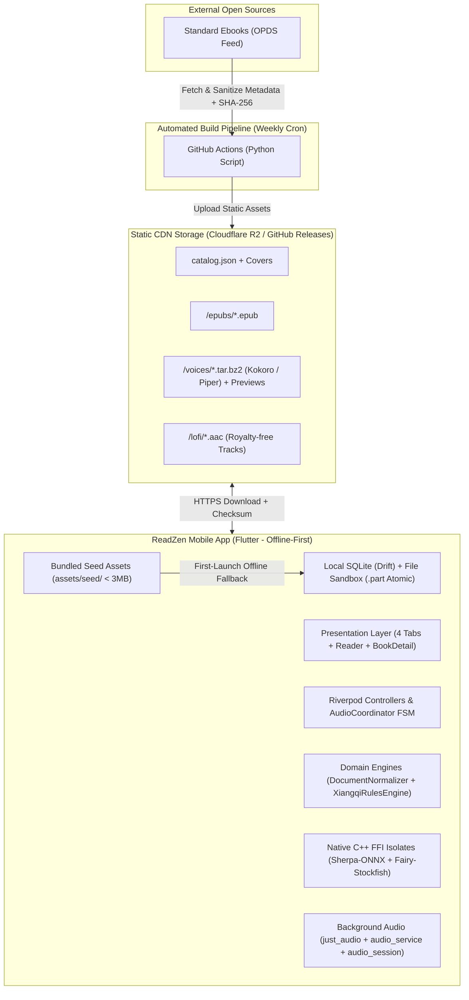
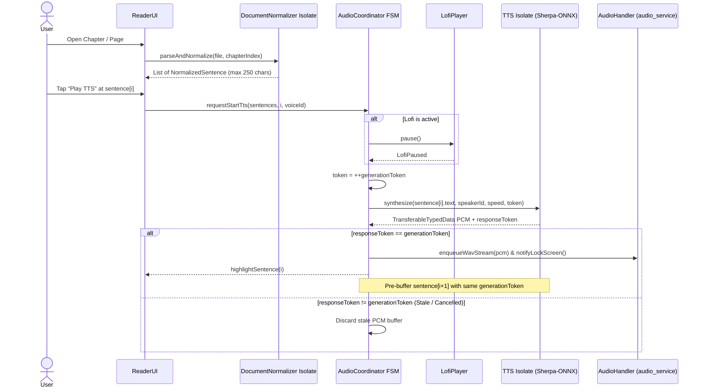
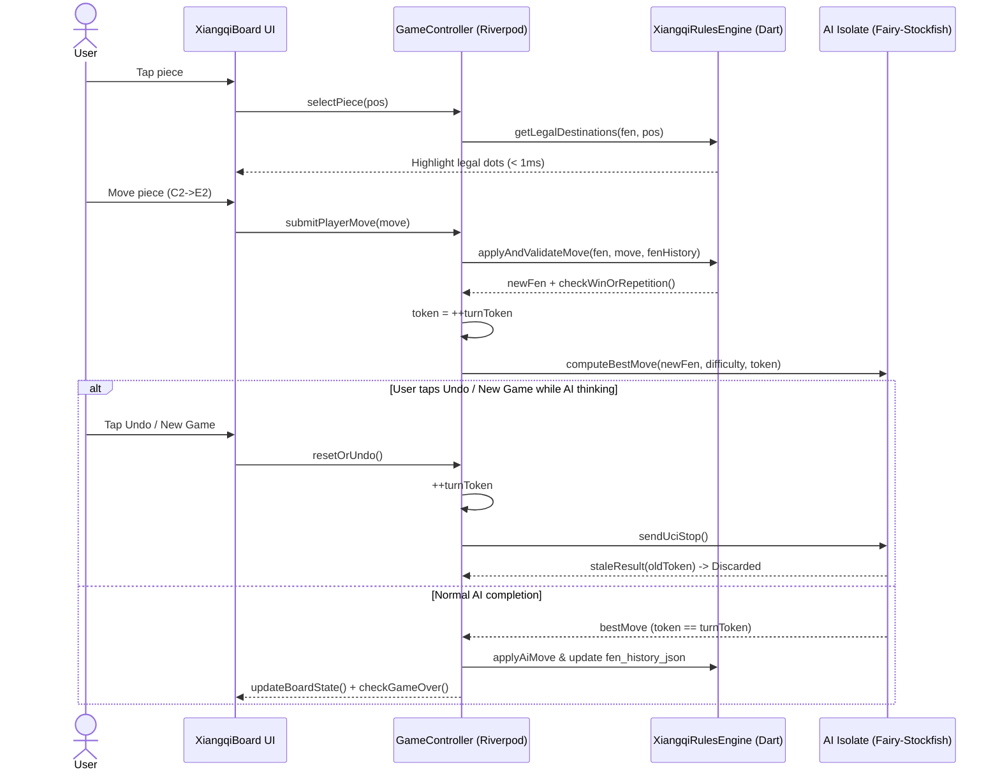
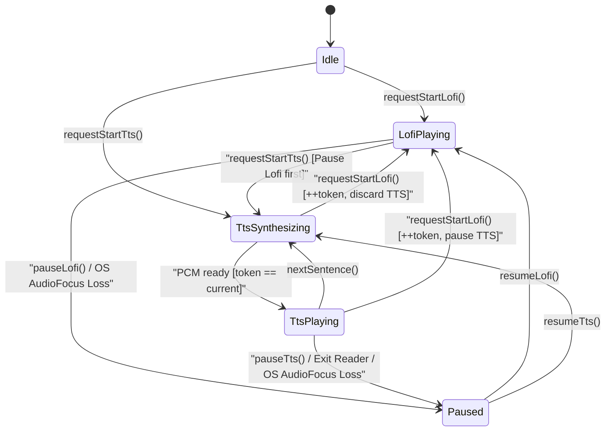
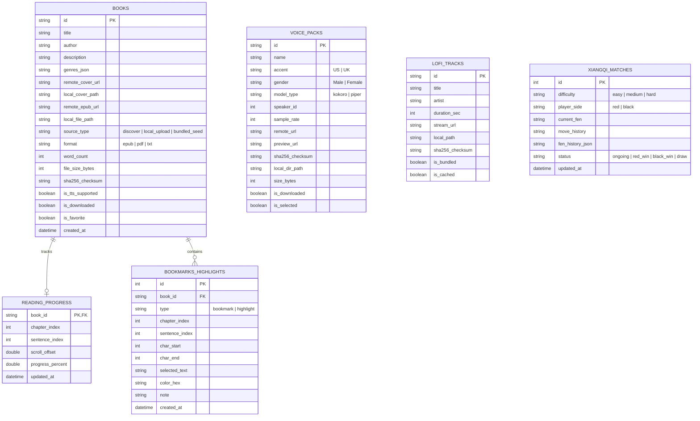
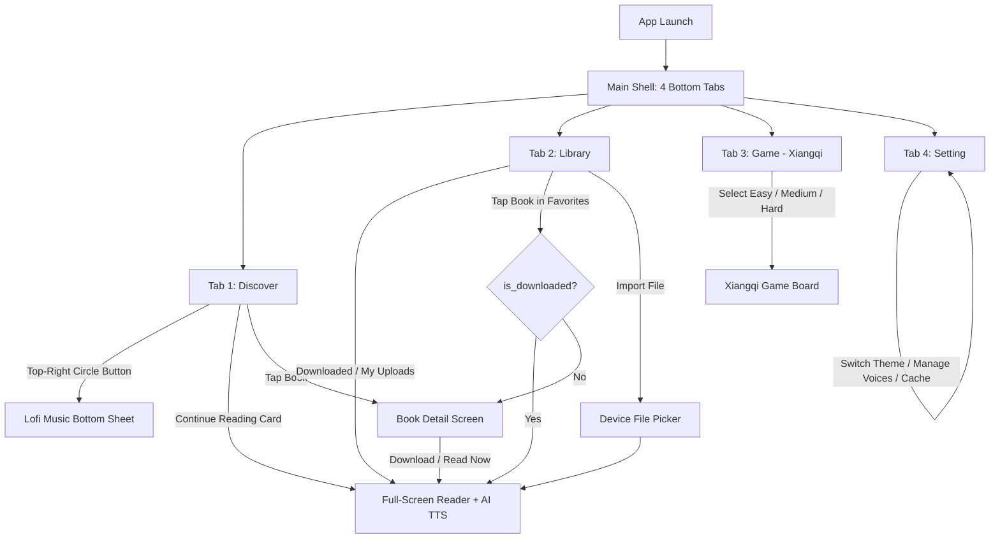

# Assignment 01: Comprehensive Software Requirements & Architecture Specification

**Project Name:** ReadZen (Ebook Reader, AI Audiobook TTS, Lofi Sanctuary & Xiangqi)  
**Platform:** Mobile Application (iOS & Android — Flutter Cross-Platform)  
**Language Scope:** English Only (UI & Book Content)  
**Business Model:** 100% Free, Offline-First, No Login / No Account Required  
**Document Version:** 1.1  
**Date:** 14 November 2026  

---

## Table of Contents
1. [Problem Analysis & Requirements Elicitation (1.1)](#1-problem-analysis--requirements-elicitation)
2. [Functional Requirements Specification (1.2)](#2-functional-requirements-specification)
3. [Non-Functional Requirements & Mobile Constraints (1.3)](#3-non-functional-requirements--mobile-constraints)
4. [System Architecture Design (1.4)](#4-system-architecture-design)
5. [Data & API Design (1.5)](#5-data--api-design)
6. [UI/UX Design, User Flows & Screen States (1.6)](#6-uiux-design-user-flows--screen-states)
7. [Traceability Matrix & Governance (1.7)](#7-traceability-matrix--governance)

---

## 1. Problem Analysis & Requirements Elicitation

### 1.1.1 Problem Statement
Người dùng đọc sách tiếng Anh trên di động hiện nay thường gặp 4 vấn đề lớn:
1. **Chi phí cao & phân mảnh:** Các app đọc sách có giọng đọc AI tự nhiên (như Speechify) thu phí thuê bao đắt đỏ (\$10–\$20/tháng), trong khi các app đọc sách miễn phí lại chỉ dùng giọng đọc hệ thống (robotic, thiếu ngữ điệu).
2. **Thiếu không gian tập trung liền mạch:** Người đọc thường phải mở song song app đọc sách (Kindle) và app nghe nhạc thư giãn (Spotify/YouTube) — gây tốn pin, dễ bị phân tâm bởi thông báo hoặc quảng cáo.
3. **Phụ thuộc Internet & Bắt buộc đăng nhập:** Nhiều ứng dụng ép người dùng tạo tài khoản và yêu cầu kết nối mạng liên tục mới cho đọc hoặc nghe TTS.
4. **Thiếu hoạt động giải trí nhẹ nhàng (Brain Break):** Sau thời gian dài đọc sách, người dùng muốn giải trí trí tuệ nhanh (như đánh một ván cờ tướng với máy) mà không phải thoát ra mở game nặng nhiều quảng cáo.

**Giải pháp đề xuất (ReadZen):** Một ứng dụng di động **miễn phí 100%, không cần đăng nhập, ưu tiên chạy Offline (Offline-First)**, tích hợp: (1) Kho sách tiếng Anh kinh điển & nhập sách cá nhân, (2) Trình đọc kèm AI TTS giọng tự nhiên, (3) Nhạc nền Lofi không lời, và (4) Cờ Tướng (Xiangqi) 3 cấp độ chơi với máy.

### 1.1.2 Stakeholders & Target Personas

| Stakeholder | Vai trò & Mục tiêu |
| :--- | :--- |
| **End Users (Người dùng cuối)** | Đọc sách tiếng Anh, nghe sách nói AI, nghe nhạc Lofi thư giãn, chơi cờ tướng offline. |
| **Development Team** | Thiết kế, lập trình, kiểm thử và bảo trì ứng dụng đạt chuẩn Assignment 01 & 02. |
| **Course Instructor / Reviewer** | Đánh giá chất lượng tài liệu đặc tả (A01) và mức độ hoàn thiện sản phẩm (A02). |
| **Open Content Providers** | Standard Ebooks (nguồn sách CC0/Public Domain), cộng đồng mã nguồn mở (Sherpa-ONNX, Kokoro, Fairy-Stockfish). |

#### Target User Personas
* **Persona 1 — Minh Anh (21 tuổi, Sinh viên IT / Luyện tiếng Anh):** Cần đọc tiểu thuyết tiếng Anh miễn phí và nghe giọng đọc AI chuẩn Mỹ/Anh để luyện kỹ năng nghe–đọc trên xe buýt (offline). Muốn giao diện tối (Dark/Sepia) đỡ mỏi mắt.
* **Persona 2 — Hoàng Nam (28 tuổi, Nhân viên văn phòng):** Thích đọc sách buổi tối trước khi ngủ kèm tiếng nhạc Lofi nhẹ nhàng để thư giãn. Khi buồn tay thích mở tab phụ đánh một ván Cờ Tướng mức Trung bình để giải trí không quảng cáo.
* **Persona 3 — Sarah (34 tuổi, Người yêu sách có sẵn file EPUB/PDF):** Đã có sẵn kho file `.epub` và `.pdf` trên điện thoại, muốn import vào một app sạch sẽ, không cần đăng nhập, hỗ trợ chuyển văn bản thành giọng nói tự nhiên.

### 1.1.3 Competitor App Analysis

| Ứng dụng | Điểm mạnh | Điểm yếu (Khoảng trống thị trường) | Giải pháp của ReadZen |
| :--- | :--- | :--- | :--- |
| **Amazon Kindle / Apple Books** | Giao diện đọc đẹp, mượt, hỗ trợ bookmark. | Không tích hợp AI TTS tự nhiên miễn phí; không có nhạc Lofi; không có mini-game. | Tích hợp sẵn AI TTS (Kokoro-82M) + Lofi + Xiangqi trong 1 app. |
| **Speechify** | Giọng đọc AI rất tự nhiên, sync chữ tốt. | Thu phí rất cao; bắt buộc đăng nhập; phụ thuộc Cloud/Internet. | Miễn phí 100%, chạy On-device AI TTS hoàn toàn Offline. |
| **Moon+ Reader** | Đọc đa định dạng, tùy biến sâu. | UI cũ kỹ; TTS mặc định dùng engine hệ thống nghe cứng. | UI chuẩn Material 3 / HIG tối giản; dùng Neural TTS biết nhấn nhá. |
| **Các app Cờ Tướng phổ biến** | Nhiều chế độ chơi. | Dày đặc quảng cáo pop-up, nặng máy, giao diện rối mắt. | Cờ Tướng tối giản, 0 quảng cáo, 3 mức AI chạy offline mượt. |

### 1.1.4 Requirements Elicitation Summary (Khảo sát & Phỏng vấn)
Để tránh giả định chủ quan và đảm bảo tính năng xuất phát từ nhu cầu thực tế, nhóm đã thực hiện quy trình thu thập yêu cầu gồm 2 pha: **Khảo sát định lượng (Google Forms, $N = 45$ người tham gia)** và **Phỏng vấn sâu bán cấu trúc ($N = 5$ người dùng mục tiêu)**.

#### A. Kết quả Khảo sát định lượng ($N = 45$: 28 sinh viên đại học, 17 nhân viên văn phòng có thói quen đọc tài liệu/sách tiếng Anh)

| Hạng mục khảo sát (Survey Question / Topic) | Kết quả chính (% Đồng ý) | Quyết định kiến trúc & Yêu cầu rút ra |
| :--- | :---: | :--- |
| **Từ chối tạo tài khoản** chỉ để đọc ebook miễn phí hoặc nghe TTS offline | **91.1% (41/45)** | Loại bỏ hoàn toàn luồng Login/Auth; toàn bộ dữ liệu lưu cục bộ bằng Drift SQLite (**No-Auth Constraint**). |
| **Không muốn nhạc nền phát đè** khi đang bật giọng đọc sách nói AI (TTS) | **86.7% (39/45)** | Áp dụng quy tắc **Mutual Exclusion 2 chiều** trong `AudioCoordinator` (Bật TTS ↔ Tắt Lofi, không tự bật lại gây giật mình). |
| **Nhu cầu tự nhập sách cá nhân** (`.epub`, `.pdf`, `.txt`) có sẵn trên điện thoại | **80.0% (36/45)** | Xây dựng mục **My Uploads** trong Tab 2 (Library) kèm trình chuẩn hóa văn bản `DocumentNormalizer` cho cả 3 định dạng. |
| **Gặp tình trạng mất mạng** khi di chuyển (xe buýt, tàu điện, máy bay) nhưng vẫn muốn đọc/nghe | **84.4% (38/45)** | Kiến trúc **Offline-First từ giây thứ 0**: đóng gói Seed Catalog + 01 sách mẫu + 01 track Lofi sẵn trong app, hỗ trợ tải full sách & Voice Pack về máy. |
| **Cần giao diện đọc dịu mắt ban đêm** (Dark/Sepia) & hoạt động giải trí nhẹ không quảng cáo | **77.8% (35/45)** | Thiết kế 3 Theme chuẩn WCAG AA (`Paper Light`, `Warm Sepia`, `Midnight Dark`) và tích hợp Tab 3 **Xiangqi (Cờ Tướng)** 0 quảng cáo. |

#### B. Tổng hợp Phỏng vấn sâu ($N = 5$ Participants)

| Mã người phỏng vấn | Hồ sơ (Khớp Persona) | Nỗi đau lớn nhất (Key Pain Points) | Yêu cầu cụ thể được đưa vào Spec |
| :--- | :--- | :--- | :--- |
| **P1, P2** | Sinh viên IT & Ngôn ngữ Anh (20–22 tuổi) | App TTS miễn phí giọng robot khó nghe; app giọng hay lại bắt trả \$15/tháng và cần Wi-Fi liên tục. | Dùng **Sherpa-ONNX (Kokoro-82M / Piper)** chạy On-device 100% offline, tốc độ `0.8x–2.0x`, highlight câu đang đọc (`FR-11`, `FR-13`). |
| **P3, P4** | Nhân viên văn phòng (26–30 tuổi) | Nghe Lofi trên YouTube trước khi ngủ hay bị quảng cáo chen ngang hoặc quên tắt làm hết pin; thích chơi cờ tướng giải trí nhanh. | Lofi Sheet có **Sleep Timer** (`15m/30m/60m`) tự fade-out (`FR-05`), phát nền qua Foreground Service (`NFR-06`) và Cờ Tướng 3 mức AI (`FR-14`). |
| **P5** | Người đọc sách chuyên sâu (34 tuổi) | Có nhiều file `.pdf` và `.epub` tải về từ máy tính, hay bị mất vị trí trang đang đọc dở khi đổi app hoặc tắt máy. | Lưu vị trí đọc chi tiết theo chương/trang/câu (`READING_PROGRESS`), hỗ trợ Bookmark & Highlight (`FR-08`, `FR-10`). |

---

## 2. Functional Requirements Specification

### 2.1 Use Case Diagram



### 2.2 Functional Requirements & MoSCoW Prioritization

| ID | Tính năng (Feature) | Tab / Màn hình | MoSCoW | Mô tả tóm tắt |
| :--- | :--- | :--- | :---: | :--- |
| **FR-01** | Duyệt & Tìm kiếm kho sách | Tab 1: Discover | **Must** | Hiển thị danh mục sách tiếng Anh (từ CDN Standard Ebooks), tìm kiếm theo tên/tác giả, lọc theo thể loại. |
| **FR-02** | Thẻ Continue Reading | Tab 1: Discover | **Must** | Hiển thị cuốn sách đang đọc dở gần nhất kèm % tiến độ và nút mở nhanh vào trang đang đọc. |
| **FR-03** | Thả Tim Yêu thích (Favorites) | Tab 1 & Tab 2 | **Must** | Nút Tim (❤️) trên mỗi cuốn sách để thêm/bỏ khỏi danh sách Favorites trong Library. |
| **FR-04** | Tải sách về máy (Offline) | Tab 1 → Tab 2 | **Must** | Tải file `.epub` từ CDN về bộ nhớ máy, hiển thị % tiến độ tải và lưu vào mục Downloaded. |
| **FR-05** | Nút tròn mở trình phát Lofi | Tab 1 (Góc phải trên) | **Must** | Nút tròn góc phải trên mở Lofi Music Sheet (chọn track nhạc không lời, Play/Pause, âm lượng, hẹn giờ tắt). |
| **FR-06** | Quản lý Tủ sách cá nhân | Tab 2: Library | **Must** | Chia 3 mục rõ ràng: **Downloaded**, **Favorites**, **My Uploads**. Cho phép xóa sách khỏi máy. |
| **FR-07** | Import sách cá nhân | Tab 2: Library | **Must** | Chọn file `.epub`, `.pdf`, `.txt` từ bộ nhớ thiết bị, parse metadata và lưu vào mục My Uploads. |
| **FR-08** | Trình đọc sách (Ebook Reader) | Reader Screen | **Must** | Hiển thị nội dung sách theo chương, mục lục (TOC), lật trang/cuộn dọc, tự động lưu vị trí đọc. |
| **FR-09** | Tùy chỉnh giao diện đọc | Reader Screen | **Should** | Đổi cỡ chữ, font chữ, giãn dòng, lề trang và chế độ cuộn/lật trang. |
| **FR-10** | Bookmark & Highlight | Reader Screen | **Should** | Đánh dấu trang (Bookmark) và bôi màu đoạn văn (Highlight) để xem lại. |
| **FR-11** | Đọc sách bằng AI TTS | Reader Screen | **Must** | Chuyển văn bản thành giọng nói ngay trong Reader (Kokoro-82M / Piper qua Sherpa-ONNX), Play/Pause, tua câu, chỉnh tốc độ (`0.8x–2.0x`). |
| **FR-12** | Tự động tắt Lofi khi bật TTS | Reader / Audio Engine | **Must** | Khi người dùng bấm Play TTS trong Reader, hệ thống tự động Pause nhạc Lofi nếu đang phát. |
| **FR-13** | Đồng bộ Highlight theo TTS | Reader Screen | **Should** | Tự động tô sáng câu đang được AI đọc và cuộn màn hình theo tiến độ giọng nói. |
| **FR-14** | Game Cờ Tướng với AI | Tab 3: Game | **Must** | Bàn cờ Tướng chuẩn luật (tướng, sĩ, tượng, xe, pháo, mã, tốt), chơi với AI có **3 mức: Easy, Medium, Hard**. |
| **FR-15** | Tiện ích ván cờ | Tab 3: Game | **Should** | Hỗ trợ Đi lại (`Undo`), Gợi ý nước đi (`Hint`), Đảo phe (Đỏ/Đen), Chơi ván mới (`New Game`), lưu ván đang chơi dở. |
| **FR-16** | Chuyển đổi Theme toàn app | Tab 4: Setting | **Must** | Chuyển đổi theme giao diện: **Paper Light**, **Warm Sepia**, **Midnight Dark**. |
| **FR-17** | Quản lý Voice Packs & Cache | Tab 4: Setting | **Must** | Tải/nghe thử/xóa các gói giọng AI TTS tiếng Anh, chọn giọng mặc định, xem và xóa dung lượng cache. |
| **FR-18** | Tra từ điển nhanh trong sách | Reader Screen | **Could** | Nhấn giữ một từ tiếng Anh để xem nghĩa ngắn gọn offline. |

### 2.3 Detailed Use Case Specifications & Testable Acceptance Criteria

#### **UC-01 & UC-02: Discover, Favorite & Download Book**
* **Actor:** End User | **Precondition:** Có kết nối mạng để đồng bộ `catalog.json` mới nhất; trường hợp mở app lần đầu ở chế độ Offline (Airplane Mode), app tự động nạp dữ liệu mồi đóng gói sẵn (`assets/seed/catalog_seed.json` + 01 sách Public Domain mẫu).
* **Main Flow:**
  1. User mở Tab 1 (Discover), xem thẻ *Continue Reading* (nếu đã có lịch sử đọc), duyệt các kệ sách hoặc nhập từ khóa tìm kiếm / lọc thể loại.
  2. User bấm icon Tim (❤️) để đánh dấu yêu thích, hoặc bấm vào sách để mở **Book Detail Screen** và chọn **Download**.
  3. App tải file `.epub` vào file tạm `.part`, kiểm tra mã băm `SHA-256`, đổi tên nguyên tử sang file chính thức trong `ApplicationDocumentsDirectory` và cập nhật `is_downloaded = true`.
* **Acceptance Criteria (AC):**
  * **AC-1.1:** Danh sách sách ở Tab 1 hiển thị tối thiểu ảnh bìa, tên sách, tác giả và nút Tim (❤️).
  * **AC-1.2:** Gõ từ khóa vào thanh tìm kiếm hoặc chọn chip thể loại lọc ra đúng danh sách sách khớp tên/tác giả/thể loại trong `< 300ms` (truy vấn cục bộ từ SQLite).
  * **AC-1.3:** Bấm nút Tim (❤️) chuyển icon sang trạng thái active ngay lập tức và sách xuất hiện trong mục **Favorites** ở Tab 2 (kể cả khi offline).
  * **AC-1.4:** Bấm **Download** hiển thị thanh `%` tiến độ và nút **Cancel**; sau khi tải xong, nút chuyển thành **Read Now** và sách có mặt trong mục **Downloaded** ở Tab 2.
  * **AC-1.5 (`FR-02` — Continue Reading Card):** Thẻ *Continue Reading* trên đầu Tab 1 hiển thị cuốn sách đọc gần nhất (ảnh bìa, tên sách, chương/trang hiện tại, `%` tiến độ); chạm vào thẻ mở thẳng vào đúng vị trí đang đọc dở trong `Reader`. Nếu chưa từng đọc cuốn nào, hiển thị thẻ gợi ý bắt đầu đọc. Nếu cuốn sách đó bị xóa ở Tab 2, Drift `watch()` stream tự động cập nhật thẻ sang cuốn gần nhất tiếp theo hoặc ẩn đi ngay lập tức.
  * **AC-1.6 (Download Integrity & Atomic `.part`):** Mọi lượt tải sách ghi vào `<book_id>.epub.part` và đối chiếu `SHA-256` trước khi đổi tên; nếu mất mạng, bấm Cancel hoặc sai checksum, hệ thống xóa file `.part` lỗi, giữ nguyên trạng thái chưa tải và hiển thị nút **Retry**.

#### **UC-03: Play & Control Lofi Music (Top-Right Circle Button)**
* **Actor:** End User | **Precondition:** Đang ở Tab 1 (Discover); có tối thiểu 01 track Lofi đi kèm sẵn trong `assets/seed/` hoặc danh sách track từ `/lofi/manifest.json`.
* **Main Flow:**
  1. User bấm vào **nút tròn ở góc phải trên** của Tab 1.
  2. Bottom Sheet Lofi Player hiện lên với danh sách nhạc không lời, nút Play/Pause, thanh trượt Volume và Sleep Timer (`Off`, `15m`, `30m`, `60m`).
  3. User chọn 1 track nhạc và bấm Play. Nếu TTS đang phát, `AudioCoordinator` tự động Pause TTS trước rồi mới phát Lofi chạy nền.
* **Acceptance Criteria (AC):**
  * **AC-3.1:** Nút tròn ở góc phải trên Tab 1 luôn hiển thị rõ ràng; khi nhạc Lofi đang phát, nút có trạng thái nhận biết trực quan (viền sáng hoặc icon sóng nhạc chuyển động nhẹ).
  * **AC-3.2:** Nhạc Lofi tiếp tục phát liên tục khi chuyển sang Tab Library, Game, Setting hoặc khóa màn hình điện thoại (qua `audio_service` Notification/Lock Screen).
  * **AC-3.3:** Khi Sleep Timer đếm ngược về `00:00`, nhạc tự động fade-out và dừng hẳn.
  * **AC-3.4 (Bidirectional Mutual Exclusion & Audio Focus):** Bấm Play Lofi trong khi AI TTS đang phát hoặc đang tổng hợp sẽ **tự động Pause TTS và hủy hàng đợi câu TTS hiện tại** trước khi phát nhạc. Khi có cuộc gọi đến, báo thức, hoặc rút tai nghe (`becomingNoisy`), âm thanh tự động tạm dừng qua `audio_session`.

#### **UC-04: Library Management & Local File Import**
* **Actor:** End User | **Precondition:** Đang ở Tab 2 (Library).
* **Main Flow:**
  1. User chuyển đổi giữa 3 phân mục: **Downloaded**, **Favorites**, **My Uploads**.
  2. Khi bấm vào một cuốn sách trong **Favorites**: nếu `is_downloaded == true` (hoặc `source_type == 'local_upload'`), mở thẳng **Reader Screen**; nếu `is_downloaded == false`, điều hướng sang **Book Detail Screen** để tải về máy trước khi đọc.
  3. Tại mục **My Uploads**, user bấm nút **Import Book**, chọn file `.epub`, `.pdf` hoặc `.txt` từ bộ nhớ máy (xin quyền File Picker Just-in-Time).
  4. App kiểm tra định dạng/kích thước, copy file vào sandbox, chạy `DocumentNormalizer` trong Background Isolate để trích xuất metadata, chia chương ảo/trang và lưu vào Drift SQLite.
* **Acceptance Criteria (AC):**
  * **AC-4.1:** Tab 2 hiển thị đầy đủ 3 khu vực tách biệt: *Downloaded*, *Favorites*, *My Uploads*.
  * **AC-4.2:** Import thành công file `.epub`, `.pdf`, `.txt` hợp lệ kích thước `<= 50MB` và mở đọc được ngay.
  * **AC-4.3 (Invalid / Oversized / Scanned File Guard):** Nếu user chọn file sai định dạng, vượt quá `50MB`, file nén hỏng hoặc PDF có mật khẩu/DRM, app hiển thị thông báo lỗi rõ ràng và không bị crash. Với file PDF dạng ảnh quét (không có text selectable), app vẫn cho phép mở đọc trực quan nhưng gắn cờ `is_tts_supported = false` và báo rõ khi user thử bật TTS.
  * **AC-4.4 (Safe Book Deletion):** Xóa sách trong *Downloaded* hoặc *My Uploads* sẽ kiểm tra nếu cuốn sách đó đang phát TTS thì dừng TTS ngay, sau đó xóa file vật lý (và `.part` nếu có), cập nhật DB và làm mới UI ở cả Tab 1 (*Continue Reading*) lẫn Tab 2 ngay lập tức qua Drift `watch()`.

#### **UC-05 & UC-06: Reader Screen & AI TTS Audiobook (Mutual Exclusion)**
* **Actor:** End User | **Precondition:** Đã có ít nhất 1 cuốn sách trong máy (hoặc sách mẫu seed) và 1 Voice Pack TTS đã tải để dùng chức năng TTS.
* **Main Flow:**
  1. User mở 1 cuốn sách → vào **Reader Screen** (`DocumentNormalizer` chuẩn hóa nội dung chương/trang hiện tại thành danh sách câu `List<NormalizedSentence>`).
  2. User đọc sách, mở Mục lục (`TOC / Bookmarks`), tùy chỉnh giao diện đọc (`Aa`), hoặc tạo Bookmark / Highlight.
  3. User bấm icon **Headphone / Play TTS** ngay trên thanh công cụ màn hình đọc.
  4. `AudioCoordinator` kiểm tra nếu nhạc Lofi đang phát → **tự động Pause nhạc Lofi**, tăng `generationToken`, sau đó khởi chạy TTS Isolate đọc từ `sentence_index` hiện tại và phát qua `AudioHandler`.
* **Acceptance Criteria (AC):**
  * **AC-5.1 (`FR-08` — Multi-format TOC & Navigation):** Điều hướng chương chính xác theo spine TOC với `.epub`; ánh xạ `1 trang = 1 chapter_index` (0-based) kèm nhảy trang nhanh với `.pdf`; tự động chia chương ảo (`<= 3.000 từ/chương` theo dòng tiêu đề hoặc ranh giới đoạn) khi import `.txt`.
  * **AC-5.2 (`FR-09` — Typography Customization):** Thay đổi font chữ, cỡ chữ (`14sp–28sp`), giãn dòng (`1.2–2.0`), lề trang và chế độ Cuộn dọc / Lật trang có hiệu lực ngay lập tức, giữ nguyên câu đang đọc (`sentence_index`) và lưu bền vững qua `SharedPreferences`.
  * **AC-5.3 (`FR-10` — Bookmarks & Highlights):** Hỗ trợ đánh dấu trang (`type = 'bookmark'`) và bôi màu đoạn văn chọn lọc kèm ghi chú (`type = 'highlight'` với `sentence_index`, `char_start`, `char_end`). Chạm vào mục đã lưu trong ngăn kéo *Bookmarks & Highlights* cuộn chính xác tới đúng chương/vị trí đó.
  * **AC-6.1 (Strict Mutual Exclusion & Race-Condition Guard):** Khi TTS bắt đầu phát, nhạc Lofi (nếu đang chạy) **phải tự động dừng ngay lập tức**. Khi bấm Pause TTS hoặc thoát Reader Screen, nhạc Lofi **giữ nguyên trạng thái Pause** (không tự động phát lại gây giật mình). Bấm tua câu nhanh hoặc đổi qua lại TTS ↔ Lofi liên tục dùng `generationToken` để hủy các buffer PCM lỗi thời, đảm bảo không bao giờ phát đè 2 âm thanh cùng lúc.
  * **AC-6.2:** Câu đang đọc được highlight rõ ràng và tự động cuộn theo tiến độ (`FR-13`); chạm vào nút Next/Prev tua đúng sang câu kế tiếp/trước đó.
  * **AC-6.3:** Thay đổi tốc độ đọc (`0.8x`, `1.0x`, `1.25x`, `1.5x`, `2.0x`) có hiệu lực ngay ở câu tiếp theo.
  * **AC-6.4:** Thoát màn hình đọc và mở lại đúng cuốn sách đó khôi phục chính xác `chapter_index`, `sentence_index` và `scroll_offset` đang đọc dở.
  * **AC-6.5 (Empty Text / Scanned PDF Guard):** Nếu chương hoặc trang PDF đang mở có `< 10` ký tự văn bản trích xuất được (ví dụ trang bìa chỉ có ảnh hoặc PDF scan), bấm Play TTS hiển thị thông báo *"This page contains images without selectable text. AI TTS is unavailable here."* thay vì treo loading.
  * **AC-6.6 (Long Sentence Chunking Guard):** Các câu dài bất thường (`> 250 ký tự`, không có dấu chấm câu) được `DocumentNormalizer` tự động cắt nhỏ tại dấu phẩy/chấm phẩy/ranh giới từ trước khi gửi xuống `TTS Isolate`, đảm bảo độ trễ `< 800ms` (`NFR-02`) và tránh tràn RAM.

#### **UC-07: Play Xiangqi (Cờ Tướng) vs AI (3 Difficulty Levels)**
* **Actor:** End User | **Precondition:** Đang ở Tab 3 (Game).
* **Main Flow:**
  1. User chọn mức độ AI: **Easy**, **Medium**, hoặc **Hard** và chọn phe (Đỏ đi trước / Đen đi sau).
  2. User chạm vào quân cờ → `XiangqiRulesEngine` (Dart Domain) tính và hiển thị các điểm hợp lệ trong `< 16ms`.
  3. User di chuyển quân → kiểm tra hợp lệ, cập nhật `fen_history_json`, sau đó gửi `(fen, difficulty, turnToken)` vào `AI Worker Isolate (Fairy-Stockfish)`.
  4. AI trả về nước đi khớp `turnToken` → cập nhật bàn cờ và kiểm tra Chiếu (Check), Chiếu bí (Checkmate), Hết nước đi (Stalemate), hoặc lặp thế cờ 3 lần.
* **Acceptance Criteria (AC):**
  * **AC-7.1:** Bàn cờ 9x10 và 32 quân cờ tuân thủ đúng 100% luật Cờ Tướng quốc tế (cản mã, cản tượng, pháo ăn qua ngòi, lộ mặt tướng, cấm tự sát, cấm chiếu vĩnh viễn / lặp thế cờ 3 lần).
  * **AC-7.2:** Cung cấp đủ 3 mức độ **Easy** (`< 300ms`), **Medium** (`< 1.0s`), **Hard** (`< 2.5s`) đúng giới hạn `NFR-03`.
  * **AC-7.3:** Nút **Undo** lùi lại đúng 1 lượt đi của cả người và máy (pop 2 plies từ `fen_history_json`); nút **Hint** hiển thị mũi tên/ô gợi ý nước đi tốt nhất từ engine.
  * **AC-7.4:** Khi có bên thắng/thua/hòa, hiển thị hộp thoại kết quả rõ ràng kèm nút **Play Again**.
  * **AC-7.5 (Concurrent AI Cancellation):** Nếu user bấm **Undo**, **New Game** hoặc **Đổi phe** trong lúc AI đang suy nghĩ (đặc biệt ở mức Hard), `GameController` tăng `turnToken` và gửi lệnh UCI `stop` xuống Isolate; kết quả tính toán của `turnToken` cũ bị loại bỏ hoàn toàn và không ghi đè lên bàn cờ mới.

#### **UC-08: App Settings (Tab 4)**
* **Actor:** End User.
* **Acceptance Criteria (AC):**
  * **AC-8.1:** Đổi Theme (`Paper Light` / `Warm Sepia` / `Midnight Dark`) áp dụng ngay lập tức cho toàn bộ 4 tab và Reader Screen, lưu bền vững sau khi tắt mở lại app.
  * **AC-8.2 (Voice Pack Lifecycle & Safe Deletion):** Mục Voice Packs kiểm tra dung lượng trống (`>= 300MB`) trước khi tải và giải nén `.tar.bz2`, kiểm tra `SHA-256`, hỗ trợ nghe thử 1 câu mẫu (`preview_url`), chọn giọng mặc định (`speaker_id`). Khi xóa gói giọng đang được nạp trong TTS, hệ thống tự động dừng TTS và giải phóng con trỏ native C++ (`SherpaOnnxOfflineTtsDestroy`) trong Isolate trước khi xóa thư mục vật lý.
  * **AC-8.3 (`FR-17` — Storage Breakdown & Safe Cache Cleaner):** Màn hình Settings hiển thị dung lượng thực tế phân tách theo 3 nhóm: *Downloaded Books*, *AI Voice Packs*, và *Temporary Cache*. Bấm **Clear Cache** xóa sạch ảnh bìa tạm, audio nghe thử và track Lofi cache trong `getTemporaryDirectory()`, đồng thời **cam kết giữ nguyên 100%** sách đã tải/import, Voice Packs, Bookmarks và tiến độ đọc trong SQLite.

---

## 3. Non-Functional Requirements & Mobile Constraints

| ID | Nhóm yêu cầu | Chỉ tiêu đo lường cụ thể (Measurable Target) |
| :--- | :--- | :--- |
| **NFR-01** | **Performance (Launch & UI)** | Thời gian khởi động app (Cold Start) `< 2.5 giây` trên thiết bị tầm trung. Tốc độ khung hình UI duy trì `60 fps` khi cuộn danh sách sách và kéo thả quân cờ. |
| **NFR-02** | **TTS Latency** | Thời gian từ lúc bấm Play TTS đến khi phát ra âm thanh câu đầu tiên `< 800ms` (với gói Kokoro/Piper đã tải sẵn trên máy). Không gây đơ/giật UI Thread. |
| **NFR-03** | **Game AI Response Time** | Thời gian AI Cờ Tướng trả về nước đi: **Easy** `< 300ms`, **Medium** `< 1.0s`, **Hard** `< 2.5s` (chạy trên Background Isolate). |
| **NFR-04** | **Offline Behaviour** | **100%** các tính năng cốt lõi (đọc sách đã tải/import, nghe AI TTS, nghe Lofi đã cache, chơi Cờ Tướng, đổi Theme) phải hoạt động bình thường khi máy ở chế độ Máy bay (Airplane Mode). |
| **NFR-05** | **Storage & App Size** | File cài đặt gốc (APK/IPA) `<= 60 MB` (nhờ tách Voice Packs và Lofi tracks thành tài nguyên tải thêm theo nhu cầu). |
| **NFR-06** | **Battery & Background Audio** | Khi phát TTS hoặc Lofi ở chế độ tắt màn hình 1 giờ, mức tiêu hao pin `< 8%` và không bị OS kill giữa chừng (nhờ Foreground Service / AVAudioSession). |
| **NFR-07** | **Platform & OS Compatibility** | Hỗ trợ **Android 8.0 (API 26)+** và **iOS 14.0+**. Tương thích tốt các tỷ lệ màn hình từ điện thoại nhỏ (360dp width) đến tablet. |
| **NFR-08** | **Permissions (Just-in-Time)** | Chỉ xin quyền truy cập tệp (`Storage / Document Picker`) khi user bấm *Import Book* và quyền `Notification` (Android 13+) khi bật phát âm thanh nền. Không xin quyền thừa (Location, Contacts, Camera). |
| **NFR-09** | **Privacy & Security** | Không thu thập dữ liệu cá nhân (Zero PII). Toàn bộ request tải sách/asset qua HTTPS (TLS 1.2+). Không hardcode secret keys trong source code. |

---

## 4. System Architecture Design

### 4.1 Overall System Architecture (Serverless Edge-First)



### 4.2 In-App Architecture (Feature-First Clean Architecture)

Ứng dụng sử dụng kiến trúc **Feature-First Clean Architecture** kết hợp **Riverpod** (State Management) và **Dart Isolates** cho toàn bộ tác vụ nặng (không chặn UI Thread).

* **Quy tắc phân tầng (Layering Rule):** Presentation Widgets chỉ giao tiếp với Riverpod Providers/Controllers; tuyệt đối không gọi Drift DAOs, Dio hay `dart:ffi` trực tiếp từ UI.
* **Cấu trúc thư mục chuẩn:**

```text
assets/
└── seed/                  # catalog_seed.json, 01 sample EPUB, 01 sample Lofi (< 3MB)
lib/
├── core/
│   ├── database/          # Drift SQLite tables, DAOs, watch() streams, migrations
│   ├── network/           # Dio client, Atomic .part DownloadManager, SHA-256 & Disk Guard
│   ├── router/            # GoRouter (StatefulShellRoute giữ trạng thái 4 tab)
│   ├── theme/             # Paper Light / Warm Sepia / Midnight Dark ThemeData (WCAG AA)
│   └── audio/             # Global AudioCoordinator FSM, generationToken, AudioHandler (audio_service)
└── features/
    ├── discover/          # Tab 1: Catalog Repo, Search, Continue Reading, Lofi BottomSheet
    ├── library/           # Tab 2: Downloaded, Favorites, My Uploads, Local File Importer
    ├── reader/            # Reader Screen: DocumentNormalizer Isolate (EPUB/PDF/TXT), TTS Sync
    ├── game/              # Tab 3: XiangqiRulesEngine (Domain) + Fairy-Stockfish Isolate + CustomPainter
    └── settings/          # Tab 4: Theme, Voice Pack Manager (Safe FFI Dispose), Cache Cleaner
```

### 4.3 Justified Technology Choices

| Thành phần | Công nghệ lựa chọn | Lý do lựa chọn (Justification) |
| :--- | :--- | :--- |
| **Framework** | **Flutter (Dart)** | 1 codebase cho iOS & Android; `CustomPainter` vẽ bàn cờ 60fps; hỗ trợ `dart:ffi` gọi thẳng C++ không qua JS bridge chậm. |
| **State Management** | **Riverpod** | Compile-safe, dễ quản lý trạng thái xuyên suốt giữa Reader, Lofi Player và 4 Tab, dễ viết Unit Test và override providers khi test. |
| **Local Database** | **Drift (SQLite)** | Type-safe SQL, hỗ trợ reactive streams (`watch`) giúp Tab 1 (*Continue Reading*) và Tab 2 tự đồng bộ ngay khi bấm Tim (❤️), tải xong hoặc xóa sách. |
| **AI TTS Engine** | **Sherpa-ONNX + Kokoro-82M / Piper** | Mã nguồn mở (Apache 2.0), chạy 100% offline trên CPU thiết bị trong Isolate riêng; hỗ trợ `speaker_id` cho đa giọng Kokoro tự nhiên, chi phí API = 0đ. |
| **Background Audio & Focus** | **just_audio + audio_service + audio_session** | Hợp nhất phát **cả Lofi lẫn luồng PCM/WAV của TTS** qua `AudioHandler` chung để sống sót khi khóa màn hình 1 giờ (`NFR-06`) và tự tạm dừng khi có cuộc gọi / rút tai nghe (`becomingNoisy`). |
| **Xiangqi Hybrid Engine** | **XiangqiRulesEngine (Dart) + Fairy-Stockfish (C++ FFI)** | Tách bạch trách nhiệm: Dart Domain kiểm tra nước đi hợp lệ & lặp 3 lần tức thì (`< 16ms`, 60fps); Fairy-Stockfish C++ Isolate chỉ lo tìm nước đi AI & Hint theo 3 mức Easy / Medium / Hard. |
| **CDN Hosting** | **Cloudflare R2 (hoặc GitHub Releases Fallback)** | Miễn phí lưu trữ & băng thông tải xuống (`$0 Egress`); cấu hình động qua `--dart-define=CDN_BASE_URL` kèm **Bundled Seed Assets** giúp app chạy mượt ngay cả khi offline hoàn toàn từ lần mở đầu. |

### 4.4 Sequence Diagrams for Main Flows

#### Flow 1: Bật Sách Nói (TTS) trong Reader, Chuẩn hóa câu & Mutual Exclusion 2 chiều


#### Flow 2: Chơi Cờ Tướng với AI (Hybrid Domain Validation + FFI Isolate + Cancel Guard)


### 4.5 Concurrency, Audio FSM & Edge-Case Resilience Architecture

1. **Máy trạng thái hữu hạn `AudioCoordinator` (FSM & Concurrency Guard):**
   * Mọi thao tác âm thanh phải đi qua `AudioCoordinator` (Single Source of Truth) theo các trạng thái rời rạc: `idle`, `lofiPlaying`, `ttsSynthesizing`, `ttsPlaying`, `paused`.
   * **Mutual Exclusion 2 chiều & Quy tắc không tự bật lại:**
     * `lofiPlaying` → nhận `requestStartTts`: gọi `LofiPlayer.pause()`, chuyển sang `ttsSynthesizing`.
     * `ttsSynthesizing` / `ttsPlaying` → nhận `requestStartLofi`: hủy tác vụ tổng hợp (`++generationToken`), tạm dừng `AudioHandler` TTS, chuyển sang `lofiPlaying`.
     * `ttsPlaying` → nhận `pauseTts` hoặc thoát `ReaderScreen`: chuyển sang `paused` hoặc `idle`; **tuyệt đối không tự động bật lại Lofi** để tránh làm người dùng giật mình.
   * **Zero-overlap Token (`generationToken`):** Mọi yêu cầu gửi xuống `TTS Isolate` mang theo `int generationToken`. Khi Isolate trả về `TransferableTypedData` (zero-copy PCM buffer), `AudioCoordinator` đối chiếu `responseToken == _currentToken`; mọi buffer thuộc token cũ (do tua nhanh câu hoặc chuyển sang Lofi) bị hủy bỏ tức thì.



2. **`DocumentNormalizer` — Mô hình định vị thống nhất đa định dạng:**
   * Chạy hoàn toàn trong Background Isolate khi mở chương/trang hoặc khi import sách để không chặn UI thread:
     * **`.epub`:** Trích xuất HTML từng chương spine, chuẩn hóa khoảng trắng, loại bỏ thẻ script/style, tách thành `List<NormalizedSentence>` kèm `(sentenceIndex, paragraphIndex, charStart, charEnd)`.
     * **`.pdf`:** Ánh xạ `1 trang PDF = 1 chapter_index` (0-based). Nếu trang chỉ là ảnh quét (tổng số ký tự trích xuất `< 10`), gắn cờ `is_tts_supported = false` cho trang/sách đó và báo thân thiện khi bấm TTS.
     * **`.txt`:** Khi import, tự động phân mảnh thành các chương ảo (`<= 3.000` từ/chương, ưu tiên ngắt tại tiêu đề `Chapter/Part` hoặc ranh giới đoạn văn).
   * **Boundary Chunking (`<= 250` ký tự):** Các câu quá dài không có dấu chấm câu được tách nhỏ tại dấu phẩy, chấm phẩy hoặc ranh giới từ (`max 250 chars`) trước khi gửi vào Sherpa-ONNX để đảm bảo `NFR-02` (`< 800ms`) và tránh lỗi OOM.

3. **Tải file nguyên tử (`.part`), Kiểm tra bộ nhớ & Giải phóng FFI an toàn:**
   * **Disk Space & Atomic Write:** Trước khi tải Voice Pack (`.tar.bz2` ~120MB), kiểm tra bộ nhớ trống `>= 300MB` (đủ cho file nén + file giải nén `.onnx`). Mọi tải xuống ghi vào `<target>.part`; chỉ sau khi đối chiếu khớp `SHA-256` mới đổi tên nguyên tử sang file đích. Khi khởi động app, tự động quét và xóa các file `.part` mồ côi do tắt app ngang.
   * **Safe Native Teardown:** Trước khi xóa một Voice Pack trong Tab 4, nếu gói đó đang được nạp, `AudioCoordinator` buộc dừng TTS và gửi lệnh `dispose()` vào `TTS Isolate` để gọi `SherpaOnnxOfflineTtsDestroy` giải phóng con trỏ C++ trước khi xóa thư mục vật lý trên đĩa (tránh crash native `SIGSEGV` / `FileSystemException`).

---

## 5. Data & API Design

### 5.1 Entity-Relationship Diagram (Local SQLite - Drift v1.1)



### 5.2 Local Storage Strategy
* **Bundled Seed Assets (`assets/seed/`):** Đóng gói sẵn `catalog_seed.json`, 01 cuốn sách mẫu Public Domain (`.epub` ~150KB), và 01 track Lofi mẫu (`.aac` ~1.5MB). Tổng dung lượng `< 3MB`, giúp APK/IPA vẫn `<= 60MB` (`NFR-05`) đồng thời bảo đảm **Offline-First từ giây thứ 0** khi mở app lần đầu ở Airplane Mode.
* **Structured Data (`Drift SQLite`):** Lưu metadata sách đầy đủ (`genres_json`, `remote_epub_url`, `sha256_checksum`, `is_tts_supported`), trạng thái `is_favorite`, tiến độ đọc chuẩn hóa đa định dạng (`READING_PROGRESS`), `BOOKMARKS_HIGHLIGHTS` kèm tọa độ ký tự, `VOICE_PACKS`, `LOFI_TRACKS` và lịch sử ván cờ (`fen_history_json`).
* **User Preferences (`SharedPreferences`):** Lưu Theme đang chọn (`Paper Light` / `Warm Sepia` / `Midnight Dark`), tùy chỉnh Typography (`fontFamily`, `fontSize`, `lineHeight`, `margin`, `readingMode`), và tốc độ TTS mặc định (`0.8x–2.0x`).
* **Binary Files (`getApplicationDocumentsDirectory()`):** Lưu file `.epub`/`.pdf`/`.txt` đã tải hoặc import và thư mục giải nén model AI TTS (`.onnx`, `voices.bin`, `tokens.txt`) để hệ điều hành không tự xóa. Mọi lượt tải đang thực hiện ghi vào `<filename>.part` và được dọn dẹp tự động lúc khởi động app nếu bị ngắt giữa chừng.
* **Temporary Cache (`getTemporaryDirectory()`):** Lưu ảnh bìa cache, audio nghe thử giọng và file nhạc Lofi tải tạm; user có thể xóa an toàn bằng nút **Clear Cache** ở Tab 4 (`AC-8.3`) mà không làm mất sách đã tải, Voice Packs hay tiến độ đọc.

### 5.3 Static CDN API Contract

**Base URL (Configurable):** Cấu hình qua `--dart-define=CDN_BASE_URL=<url>` (mặc định trỏ tới **Cloudflare R2 Public Bucket** hoặc **GitHub Releases Static CDN** do nhóm phát hành; khi ngoại tuyến tự động fallback về `assets/seed/`).

| Endpoint | Method | Mô tả | Response Schema (Khớp 1:1 với Drift ERD) |
| :--- | :---: | :--- | :--- |
| `/catalog.json` | `GET` | Lấy danh mục sách tiếng Anh (Discover) | `{ "updated_at": "2026-11-14T00:00:00Z", "books": [ { "id": "se-1", "title": "...", "author": "...", "description": "...", "genres": ["Fiction", "Classics"], "remote_cover_url": "https://...", "remote_epub_url": "https://...", "word_count": 48000, "file_size_bytes": 524288, "sha256_checksum": "..." } ] }` |
| `/epubs/{book_id}.epub` | `GET` | Tải file sách EPUB | Binary stream (`application/epub+zip`) kèm header `Content-Length` |
| `/lofi/manifest.json` | `GET` | Danh sách các track nhạc Lofi không lời | `{ "tracks": [ { "id": "lofi-rain", "title": "Midnight Rain", "artist": "ReadZen Studio", "duration_sec": 185, "stream_url": "https://...", "sha256_checksum": "..." } ] }` |
| `/voices/manifest.json` | `GET` | Danh sách các gói giọng AI TTS | `{ "voices": [ { "id": "kokoro-af-heart", "name": "Heart (US Female)", "accent": "US", "gender": "Female", "model_type": "kokoro", "speaker_id": 0, "sample_rate": 24000, "size_bytes": 125829120, "remote_url": "https://...", "preview_url": "https://...", "sha256_checksum": "..." } ] }` |

#### Error Handling & Edge-Case Contract
| Mã / Tình huống lỗi | Hành vi xử lý của hệ thống (Deterministic Behavior) |
| :--- | :--- |
| **`200 OK`** | Parse JSON / lưu stream vào `<filename>.part` → kiểm tra `SHA-256` → đổi tên nguyên tử sang đích và cập nhật Drift DB. |
| **`404 Not Found` / `410 Gone`** | Xóa `.part` (nếu có) → hiển thị snackbar *"Content unavailable, please refresh catalog"* kèm nút **Retry**. |
| **`Network Timeout / SocketException` (Catalog)** | Tự động fallback đọc danh mục đã lưu trong Drift DB (hoặc `assets/seed/catalog_seed.json` ở lần mở đầu tiên) và hiển thị banner *"Offline Mode: Showing cached library"*. |
| **`Network Loss` (Khi đang stream Lofi chưa cache)** | Tự động chuyển phát track đã cache cục bộ (hoặc track Lofi seed đi kèm sẵn) và báo *"Network lost — switched to offline track"*. |
| **`Checksum Mismatch` / Tải gián đoạn** | Xóa ngay file `.part` lỗi, giữ nguyên trạng thái `is_downloaded = false`, không cho phép nạp vào Reader/FFI, hiển thị nút **Retry**. |
| **`StorageFullException` (`< 300MB` trống)** | Chặn trước khi tải Voice Pack và thông báo *"Insufficient storage (requires at least 300MB free space). Clear cache or free space to continue."* |
| **`Scanned PDF / Empty Text` (`< 10` ký tự)** | Vẫn cho phép đọc trực quan PDF nhưng gắn `is_tts_supported = false`; bấm TTS hiển thị thông báo rõ ràng, không treo loading. |
| **`Active Resource Deletion`** | Xóa sách/Voice Pack đang chạy TTS → `AudioCoordinator` dừng TTS và gọi `SherpaOnnxOfflineTtsDestroy` giải phóng con trỏ C++ trước khi xóa file trên đĩa. |

---

## 6. UI/UX Design, User Flows & Screen States

### 6.1 Navigation & User Flow Overview



### 6.2 Screen Specifications & Required UI States

Tuân thủ **Material Design 3** (Android) và **Apple Human Interface Guidelines** (iOS), đảm bảo mọi màn hình và sheet đều xử lý đủ **4 trạng thái (`Normal`, `Loading`, `Empty`, `Error`)**:

1. **Tab 1 — Discover:**
   * **Normal:** Top Bar có tiêu đề + ô Search + filter thể loại + **Nút tròn góc phải trên** (icon tai nghe/nốt nhạc có viền sáng khi Lofi đang phát). Bên dưới là thẻ *Continue Reading* (tự động đồng bộ qua Drift `watch()`) và các kệ sách cuộn ngang. Mỗi bìa sách có nút **Tim (❤️)** ở góc.
   * **Loading:** Shimmer skeleton mô phỏng thẻ Continue Reading và các kệ bìa sách.
   * **Empty (Search/Filter không có kết quả):** Icon kính lúp + thông báo *"No books found for '[query]'. Try another title or import your own file in Library."* + nút xóa bộ lọc.
   * **Error (Lỗi đồng bộ khi chưa có cache mạng):** Hiển thị banner *"Offline Mode: Showing bundled catalog"* với dữ liệu từ `assets/seed/catalog_seed.json` kèm nút **Retry**; nếu lỗi parse nghiêm trọng thì hiện trạng thái lỗi + nút **Retry**.
2. **Book Detail Screen (Điều hướng từ Tab 1 hoặc sách chưa tải trong Favorites):**
   * **Normal:** Ảnh bìa độ phân giải cao, tên sách, tác giả, chip thể loại, số từ/dung lượng ước tính, mô tả tóm tắt, nút **Tim (❤️)** và nút CTA chính (**Download** → thanh tiến độ `%` + nút **Cancel** → **Read Now**).
   * **Loading:** Skeleton cho metadata mô tả và vòng xoay tiến độ tải file kèm `%` thời gian thực.
   * **Empty (Sách không có mô tả từ nguồn OPDS):** Hiển thị thông điệp *"No synopsis available for this public domain edition."* thay cho vùng trống.
   * **Error (Tải lỗi / 404 / Sai Checksum / Mất mạng):** Xóa file `.part` lỗi, hiện snackbar/inline alert nguyên nhân cụ thể kèm nút **Retry Download**.
3. **Lofi Music Bottom Sheet (Mở từ nút tròn góc phải trên Tab 1):**
   * **Normal:** Tên track & nghệ sĩ, sóng nhạc tối giản, nút Play/Pause, thanh trượt Volume, danh sách track, và Sleep Timer (`Off`, `15m`, `30m`, `60m`). Hiển thị nhãn *"TTS paused"* nếu vừa tự động tắt TTS.
   * **Loading:** Trạng thái buffering nhẹ trên nút Play/Pause khi tải stream track mới hoặc đồng bộ `/lofi/manifest.json`.
   * **Empty (Không tải được danh sách mở rộng):** Vẫn hiển thị tối thiểu 01 track Lofi đi kèm sẵn trong `assets/seed/` để user luôn có nhạc nghe offline.
   * **Error (Mất mạng khi stream track chưa cache):** Tự động fallback sang track đã cache/seed gần nhất và hiện thông báo *"Network lost — switched to offline track"* + nút **Retry**.
4. **Tab 2 — Library:**
   * **Normal:** Segmented Tab Bar gồm 3 mục: `Downloaded` | `Favorites` | `My Uploads`. Có nút `+ Import Book` ở mục *My Uploads* và menu xóa sách an toàn trên từng item.
   * **Loading:** Shimmer grid/list khi đọc danh sách từ SQLite hoặc thanh tiến trình *"Importing & normalizing book..."* khi chạy `DocumentNormalizer` Isolate cho file `.epub`/`.pdf`/`.txt`.
   * **Empty (từng sub-tab):**
     * *Downloaded trống:* *"No downloaded books yet. Explore Discover to download classics."* + nút chuyển sang Tab 1.
     * *Favorites trống:* *"Tap the heart icon on any book to save it here."*
     * *My Uploads trống:* *"Import your own .epub, .pdf, or .txt files to read and listen."* + nút `Import Now`.
   * **Error (Import sai định dạng / `> 50MB` / File hỏng / DRM):** Hiện dialog/snackbar giải thích rõ lỗi (không crash) + nút chọn lại file; nếu thiếu quyền đọc file thì nhắc cấp quyền Just-in-Time.
5. **Reader Screen (Full-Screen + AI TTS Bar):**
   * **Normal:** Chạm giữa màn hình để ẩn/hiện thanh công cụ. Thanh dưới gồm: `TOC / Bookmarks`, `Typography (Aa)` (`14sp–28sp`, font, giãn dòng, lề, cuộn/lật trang), và `Listen (TTS)`. Khi bật TTS, thanh audio hiện lên (Play/Pause, Prev/Next câu, Tốc độ `0.8x–2.0x`, Đổi giọng), highlight câu đang đọc và tự động tắt Lofi.
   * **Loading:** Chỉ báo tải nhẹ khi `DocumentNormalizer` Isolate phân tách chương lớn hoặc khi `TTS Isolate` khởi tạo model lần đầu.
   * **Empty (Chương trống / Danh sách Bookmarks trống):** Hiển thị *"This section has no text content"* hoặc *"No bookmarks or highlights yet"* trong ngăn kéo TOC/Bookmarks.
   * **Error:**
     * *Chưa tải Voice Pack khi bấm TTS:* Dialog gợi ý tải nhanh gói giọng mặc định hoặc chuyển tới `Tab 4 → Voice Packs`.
     * *PDF Scan / Trang chỉ có ảnh (`< 10` ký tự):* Hiện thông báo *"This page contains images without selectable text. AI TTS is unavailable here."*
     * *Lỗi file vật lý bị xóa ngoài app:* Hiện thông báo kèm nút **Back to Library** / **Re-download**.
6. **Tab 3 — Game (Cờ Tướng / Xiangqi):**
   * **Normal:** Gồm 2 chế độ: *Lobby/Setup* (chọn mức **Easy / Medium / Hard**, chọn phe Đỏ/Đen, hoặc nút **Resume Match** nếu có ván đang chơi dở) và *In-Game* (Bàn cờ 9x10 vector sắc nét tự đổi màu theo Theme, chấm gợi ý nước đi hợp lệ `< 16ms`, thanh công cụ `Undo`, `Hint`, `New Game`).
   * **Loading:** Chỉ báo *"AI is thinking..."* không khóa nút `Undo` / `New Game` (nhờ `turnToken` + UCI `stop`).
   * **Empty (Chưa có ván nào được lưu):** Ở màn hình Setup hiển thị trạng thái sẵn sàng bắt đầu ván mới (*"Start a new Xiangqi match vs AI"*).
   * **Error (Lỗi nạp thư viện C++ FFI hoặc nước đi không hợp lệ):** Rung nhẹ / cảnh báo khi đi sai luật; nếu Isolate engine gặp sự cố, tự khởi tạo lại Isolate từ `current_fen` và hiện nút **Retry AI Move**.
7. **Tab 4 — Setting & Voice Pack Manager:**
   * **Normal:** *Appearance* (`Paper Light` / `Warm Sepia` / `Midnight Dark`), *AI Voice Packs* (danh sách giọng US/UK Male/Female, nghe thử, tiến độ tải, chọn mặc định, xóa an toàn), *Storage & Cache* (phân tách dung lượng Books / Voices / Cache + nút **Clear Cache**), *About App*.
   * **Loading:** Skeleton cho danh sách `/voices/manifest.json`, thanh `%` tiến độ tải và giải nén `.tar.bz2`, hoặc vòng xoay tính dung lượng bộ nhớ.
   * **Empty (Offline chưa đồng bộ manifest Voice Pack):** Hiển thị danh sách các gói đã tải trong máy (nếu có) kèm thông điệp *"Connect to internet to download additional AI voice packs"* + nút **Refresh**.
   * **Error (Thiếu dung lượng `< 300MB` / Mất mạng / Sai Checksum khi tải Voice Pack):** Xóa file `.part`, hiển thị nguyên nhân rõ ràng kèm nút **Retry** hoặc gợi ý **Clear Cache**.

### 6.3 Accessibility & Prototype Checklist
* **Accessibility:** Tương phản màu đạt chuẩn WCAG AA trên cả 3 theme; mọi icon button đều có `Semantics` label cho TalkBack/VoiceOver; vùng chạm tối thiểu `48x48 dp`.
* **Prototype:** *(Đội ngũ thiết kế gắn link Figma Interactive Prototype vào mục này khi nộp Assignment 01).*

---

## 7. Traceability Matrix & Governance

### 7.1 Requirements Traceability Matrix

| Req ID | Feature & Acceptance Criteria | Use Case | Screen / UI | Architecture Component / Table |
| :--- | :--- | :--- | :--- | :--- |
| **FR-01, FR-02** | Browse, Search, Continue Reading (`AC-1.1`, `AC-1.2`, `AC-1.5`) | UC-01 | Tab 1: Discover | `DiscoverRepo`, `Bundled Seed Assets`, `BOOKS`, `READING_PROGRESS` |
| **FR-03, FR-04** | Favorite (❤️) & Atomic Download EPUB (`AC-1.3`, `AC-1.4`, `AC-1.6`) | UC-02 | Tab 1, Book Detail, Tab 2 | `DownloadManager (.part + SHA-256)`, `BOOKS` (`is_favorite`, `is_downloaded`) |
| **FR-05** | Top-Right Lofi Music Control & Audio Focus (`AC-3.1`..`AC-3.4`) | UC-03 | Tab 1 (Top-Right Button) → Lofi Sheet | `AudioCoordinator FSM`, `LofiPlayer`, `AudioHandler`, `LOFI_TRACKS` |
| **FR-06, FR-07** | Library 3 Sub-tabs & Local Import (`AC-4.1`..`AC-4.4`) | UC-04 | Tab 2: Library, Book Detail | `LocalImporter`, `DocumentNormalizer`, `BOOKS` |
| **FR-08, FR-09, FR-10** | Reader TOC, Typography, Bookmarks/Highlights (`AC-5.1`..`AC-5.3`, `AC-6.4`) | UC-05 | Reader Screen | `ReaderController`, `DocumentNormalizer`, `READING_PROGRESS`, `BOOKMARKS_HIGHLIGHTS` |
| **FR-11, FR-12, FR-13** | AI TTS, 2-Way Mutual Exclusion, Sync Highlight, Empty/Long Guards (`AC-6.1`..`AC-6.6`) | UC-06 | Reader Screen (TTS Bar) | `AudioCoordinator FSM (generationToken)`, `TTS Isolate (Sherpa-ONNX)`, `AudioHandler`, `VOICE_PACKS` |
| **FR-14, FR-15** | Xiangqi 3 Levels, Rules, Undo, Hint, Cancel (`AC-7.1`..`AC-7.5`) | UC-07 | Tab 3: Game (Xiangqi) | `GameController`, `XiangqiRulesEngine`, `AI Isolate (Fairy-Stockfish)`, `XIANGQI_MATCHES` |
| **FR-16, FR-17** | Theme Switcher, Safe Voice Pack Mgmt & Cache Cleaner (`AC-8.1`..`AC-8.3`) | UC-08 | Tab 4: Setting | `ThemeProvider`, `VoicePackRepo`, `CacheCleaner` |
| **NFR-01..09** | Performance, Offline-First Seed, Security, Privacy | All UCs | All Screens | Isolates, Foreground Service, `audio_session`, Drift SQLite, HTTPS |

### 7.2 Change Log Policy (For Assignment 02 Compliance)
Mọi thay đổi thiết kế hoặc phạm vi tính năng trong quá trình code Assignment 02 phải được ghi nhận vào bảng dưới đây kèm lý do cụ thể:

| Version | Date | Change Description | Rationale | Author |
| :---: | :---: | :--- | :--- | :--- |
| 1.0 | 2026-11-14 | Initial baseline specification (4 Tabs, No Auth, Offline TTS + Lofi Mutual Exclusion, Xiangqi 3 levels). | Baseline for Assignment 01 & 02 acceptance. | Team |
| 1.1 | 2026-11-14 | Architectural hardening & rubric alignment: (1) Added quantitative survey ($N=45$) & interview ($N=5$) summary in §1.1.4; (2) Added missing ACs (`AC-1.5`, `AC-1.6`, `AC-3.4`, `AC-5.1`..`AC-5.3`, `AC-6.5`, `AC-6.6`, `AC-7.5`, `AC-8.3`); (3) Added `AudioCoordinator` FSM + `generationToken`, `DocumentNormalizer` unified locator, `XiangqiRulesEngine` hybrid validation + `turnToken`, atomic `.part` + SHA-256 + disk guard + safe FFI teardown in §4; (4) Normalized Drift ERD & 1:1 API Contract + Bundled Seed Assets (`assets/seed/`) in §5; (5) Fixed `Favorites` navigation & completed all 4 UI states across all 7 screens/sheets including `Book Detail Screen` in §6. | Eliminate concurrency/FFI race conditions, handle offline cold-start & malformed file edge cases, and align 100% with `AGENTS.md` and `evaluation_criteria.md`. | Team |

### 7.3 Declaration of AI Tools Usage
* Công cụ AI được sử dụng để hỗ trợ rà soát cấu trúc tài liệu đặc tả, vẽ sơ đồ Mermaid và chuẩn hóa các tiêu chí kiểm thử (Acceptance Criteria) dựa trên các quyết định kiến trúc của nhóm. Mọi yêu cầu nghiệp vụ, cấu trúc 4 tab và lựa chọn công nghệ đều được đội ngũ phát triển kiểm duyệt và làm chủ.
